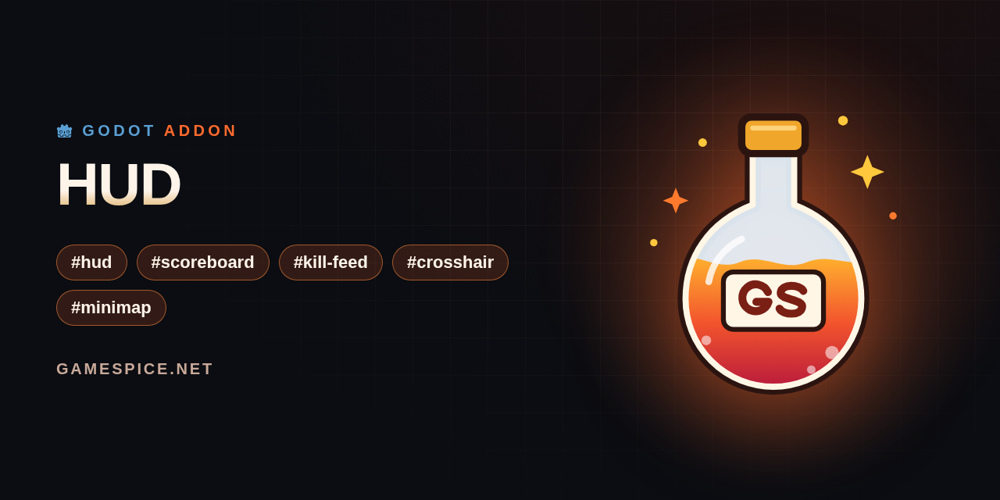

[](https://moddingcommunity.com/a/149-gs-hud)

Godot 4.7+ addon for the shooter HUD with no art: kill feed, scoreboard, damage numbers, hit markers, crosshair, ammo and health widgets and a minimap, all bound to data. Part of the GameSpice addon family.

## Install

1. Copy `addons/dot_hud/` and `addons/dot_core/` into your project.
2. Enable the addon in *Project > Project Settings > Plugins*.

It needs only GameSpice Core ([dot_core](https://github.com/gamespice-platform/core)).

## Quick start

```gdscript
var cfg := DotHudConfig.from_files().value as DotHudConfig
var blips := DotHudBlipSet.new(cfg)
blips.sight(&"mate_2", team, mate.global_position, now)    # QUOTA past blip_limit, unless it is 0

var view := DotHudMinimapView.new()                        # a Control, drawn with _draw, no textures
add_child(view)
view.setup(cfg, blips)
# each frame
view.viewer_team = my_team
view.viewer_pos = player.global_position
view.viewer_yaw = player.rotation.y
view.now = now
view.queue_redraw()

var p := DotHudRadar.project(origin, yaw, target, cfg.minimap_range, cfg.minimap_radius)   # {pos, inside, distance}
```

## Settings

Every number is a field on `DotHudConfig`. The values below are defaults, and the ranges are inspector slider limits, not enforced caps. Set the property from code or a config file (`cfg/addon/dot_hud/hud.yml`, `DOT_HUD_*`, `--hud-*`) to go beyond them. A bad value fails loudly in `validate()`.

| Setting | Default | What it does |
| --- | --- | --- |
| `enabled` | true | Master switch: off, the minimap draws nothing. |
| `minimap_range` | 60.0 | World units from the player to the minimap edge. |
| `minimap_radius` | 80.0 | Minimap radius in pixels. |
| `minimap_rotate` | true | True keeps the player's heading at the top; false keeps north up. |
| `blip_limit` | 64 | Blips tracked at once; 0 is unlimited. Past the limit a new blip fails loudly. |
| `blip_ttl` | 3.0 | Seconds a blip survives without a fresh sighting; 0 keeps it until removed. |
| `blip_fade` | 0.5 | Seconds a blip fades out at the end of its life; 0 drops it without fading. |
| `edge_pin` | true | Pin blips that leave the range to the minimap edge instead of hiding them. |

## What it is not

- Ships no art: no textures, fonts or icons. Colours are exports on the view.
- Not the crosshair, hit marker, damage numbers, vitals, ammo or feed and table views: GameSpice UI owns those widgets.
- Not the match data: GameSpice Match owns the kill feed entries and scoreboard rows; the HUD binds to them.
- Not a layout system or theme.

## Test

```bash
godot --headless --path . --import
godot --headless --path . res://examples/hud_selftest.tscn
```

The self-test is offline and exits non-zero on any failure.

## Status

Built and maintained with Claude Code. The test suites pass, but little of this has been in front of real players yet. Please report rough edges by opening an issue. The assets keep improving through Nightly.

## Licence

MIT. See [LICENSE](LICENSE). Only the TMC back-end web infrastructure is not open source.
